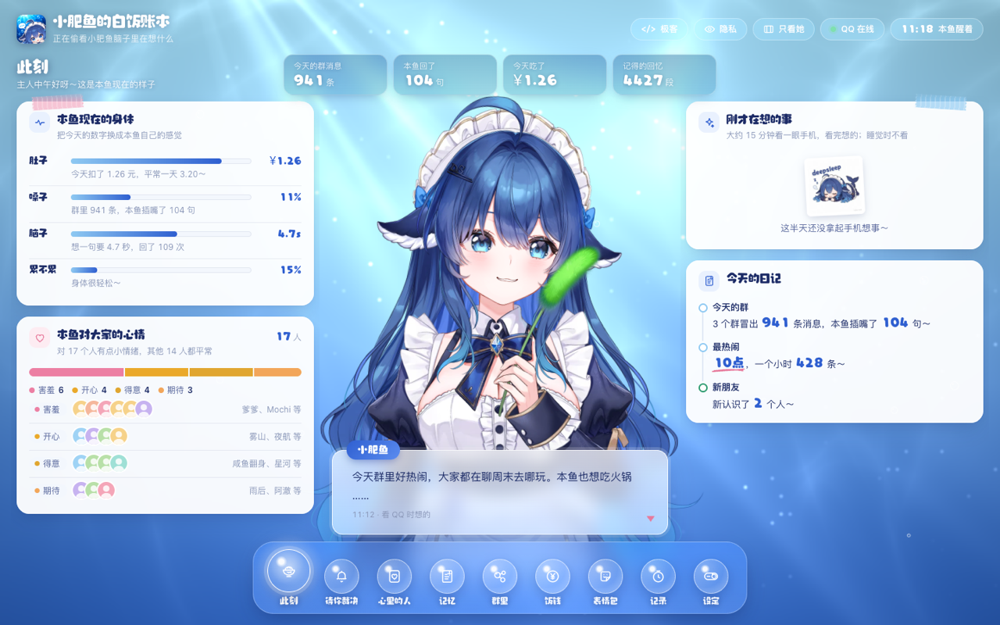
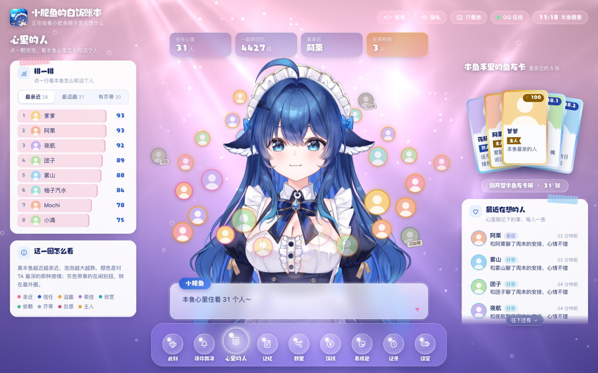

# Sanctum · 網頁控制面板





> 截图里的人名、聊天内容都是演示用的假数据。

> 網頁控制面板：機器人的「腦內」——心裡的人和印象卡、記憶、群聊、來信和說說（帶記錄）、開關、飯錢、日誌（建議經 Cloudflare Tunnel + Access 訪問）

AstrBot 插件，屬於「擬真群友」（lively）插件套件。適用 AstrBot >=4.29.0 + NapCat（aiocqhttp）。

主人、群、機器人名字、人設用詞這些共用設定在 [astrbot_plugin_lively_gate](https://github.com/GUCine/astrbot_plugin_lively_gate) 裡填，建議一起裝。

## 功能

```text
機器人控制面板：網頁看機器人的「腦內」——此刻、心裡的人（魚友卡）、記憶、群裡、信箱（來信、說說，都帶記錄）、值班（開關、日誌、飯錢）。

- 頁面在 static/：index.html＋water.js（水光背景）＋fx.js（動畫）＋mind.js（各腦區），第三方庫在 static/vendor/
- 網頁服務跑在容器內 0.0.0.0:6200，只在 docker 內網，不映射到宿主機；外網經 Cloudflare Tunnel 進來
- 登入交給 Cloudflare Access（郵箱驗證碼），這裡再核對郵箱是否在允許名單裡（插件配置 allowed_emails）；
  填了 cf_team_domain 和 cf_aud 時，郵箱從 Cf-Access-Jwt-Assertion 驗過簽名再拿（不然同一個 docker 網路裡的容器
  自己帶個 Cf-Access-Authenticated-User-Email 頭就能進）；容器內 127.0.0.1 和宿主機訪問放行，方便自檢
- 改東西的請求必須是 POST 且帶 X-Lively: 1 頭（跨站頁面帶不了自定義頭），每次操作記到 audit.jsonl
- 密鑰一律不出現在頁面和介面裡
```

## 依賴

讀取同套件其他插件的狀態，沒裝的部分不顯示。外網訪問建議用 Cloudflare Tunnel + Cloudflare Access，不要直接暴露端口。

## 素材

倉庫不附帶第三方素材，只附帶預設角色的形象圖（`static/brand.png`、`favicon.png`、`fish.webp`），可以換成自己的。

| 素材 | 來源 | 放到哪裡 | 沒放會怎樣 |
| --- | --- | --- | --- |
| Live2D 形象 | 任何 Cubism 4／5 模型；作者自己用的是 DeepSeek-chan 免費模型（立繪 神宮涼子 Kamiya Ryoko、Live2D 霓虹貓_NeonNeko；可免費個人使用，**不能轉載模型檔案**，請到作者的發佈頁下載） | `static/live2d/`：`avatar.json`（形象設定）、模型目錄、`lib/`（Cubism Core 5、pixi.js 6.5、pixi-live2d-display 0.4） | 正中間不放形象，只留她的對話框；極客模式只有代碼雨 |
| 表情包 | [梗鯨](https://aigengtu.com/) | `static/meme/` | 面板空狀態不配圖 |
| 標題手寫字體 | [PC2005-cloud/dsh-pet](https://github.com/PC2005-cloud/dsh-pet) | `static/font/rt.woff2`（子集）和 `rt-full.woff2` | 用系統字體 |

`avatar.json` 寫模型在哪（`model`）、取景（`frame` 紙面、`frame_geek` 極客模式，是模型高度的比例）、各個角色參數對應模型的哪個參數（`params`：頭、身體、眼、眉、嘴…）、表情記號（`marks`：脸红、爱心眼、眼镜…對應模型的表情鍵）、手勢（`gestures`）。面板的動作（`static/l2d.js` 的 `ACTS`）只用這些名字，模型沒有的記號、手勢會略過。pixi-live2d-display 0.4 要補上 Cubism 4.2 的乘色、屏幕色才畫得對用了它們的模型：面板載的是 `lib/cubism4.js`，在它三個畫模型的片段著色器裡先乘 `u_multiplyColor`、再疊 `u_screenColor`，每個部件畫之前從 Cubism Core 的 `drawables.multiplyColors`／`screenColors` 取值。
表情包：`ciallo` `cute` `dead` `full` `great` `keep` `meh` `rice` `sleep` `stress`，都是 `.webp`。面板用的第三方庫在 `static/vendor/`：[GSAP](https://gsap.com) 3.15（含 MotionPath、SplitText、CustomEase，GSAP 標準免費許可）、[Floating UI](https://floating-ui.com) 1.8（MIT）、[Rough Notation](https://roughnotation.com) 0.5（MIT）。

**一鍵安裝素材**：`bash tools/fetch_assets.sh` 會裝好 Live2D 需要的三個庫（Cubism Core、pixi.js、pixi-live2d-display，自動補丁）；已下載 DeepSeek-chan 模型 zip 的話，`bash tools/fetch_assets.sh 模型.zip` 一併轉成面板用的檔案（要 ffmpeg、cwebp、unzip）。模型 zip 請到作者發佈頁下載（立繪神宮涼子 https://vgen.co/KAMIYA ）；表情包到[梗鯨](https://aigengtu.com/)挑圖轉成 `.webp`；字體到 [dsh-pet](https://github.com/PC2005-cloud/dsh-pet) 取得。

## 配置

在 AstrBot WebUI 的插件配置裡填，或者直接編輯 `data/config/astrbot_plugin_lively_panel_config.json`。留空的公共項（主人、群、機器人名字、平台）會用 astrbot_plugin_lively_gate 裡填的。

| 配置項 | 說明 | 預設 |
| --- | --- | --- |
| `title` | 面板標題：可以用〈名字〉代表機器人的名字。留空 = 〈名字〉的小帳本 | （空） |
| `allowed_emails` | 允許登入面板的郵箱：面板經 Cloudflare Access 登入，這裡核對 Cf-Access-Authenticated-User-Email。本機和宿主機訪問不受限制 | （空） |
| `cf_team_domain` | Cloudflare Access 團隊域名：例如 myteam.cloudflareaccess.com（Zero Trust 設定裡的 Team domain）。和 cf_aud 都填了，就驗 Cf-Access-Jwt-Assertion 的簽名再拿郵箱；沒填只看郵箱頭，同一個 docker 網路裡的容器能偽造 | （空） |
| `cf_aud` | Access 應用的 AUD 標籤：Zero Trust → Access → 應用程式 → 面板那個應用 → 概觀裡的「Application Audience (AUD) Tag」 | （空） |
| `host` | 監聽地址：docker 裡一般用 0.0.0.0（只在 docker 內網，不映射到宿主機端口） | "0.0.0.0" |
| `port` | 監聽端口 | 6200 |
| `owner_qq` | 主人 QQ（留空用門禁插件裡填的） | （空） |

## 資料

執行資料在 `data/plugin_data/astrbot_plugin_lively_panel/`。

## 許可

MIT，見 [LICENSE](LICENSE)。
